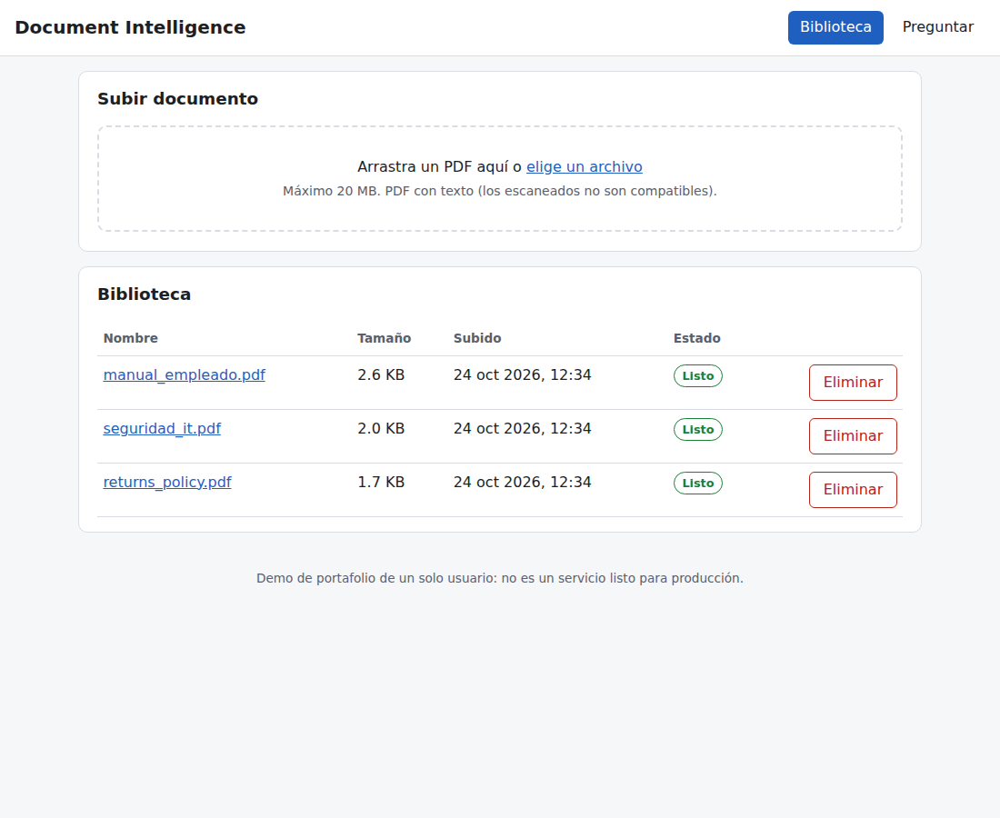
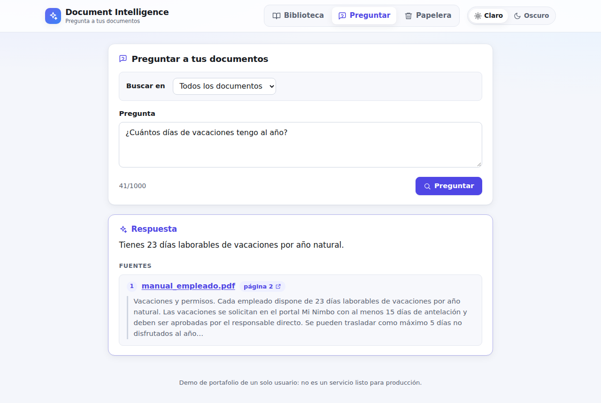
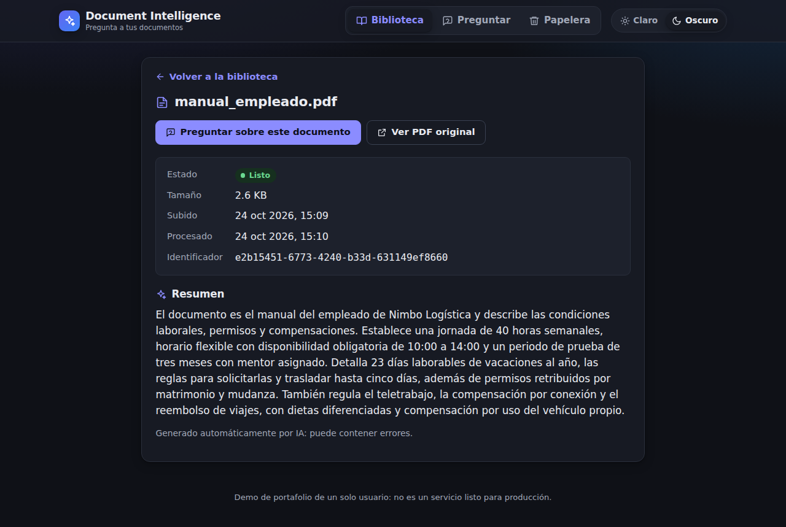
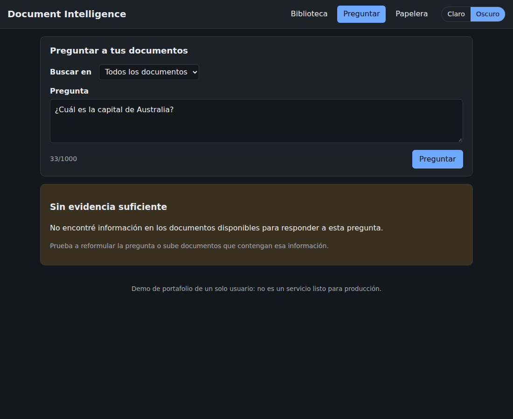
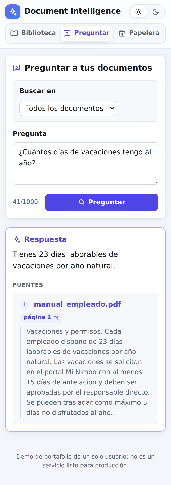

# AI Document Intelligence Platform

Aplicación web para cargar documentos PDF y hacerles preguntas en lenguaje natural mediante RAG
(Retrieval-Augmented Generation), con respuestas que citan el documento y la página de origen.

> **Estado:** MVP completo (Fase 7). Proyecto de portafolio / aprendizaje; **no** es un servicio
> listo para producción ni para exponerse a Internet (no tiene autenticación; los límites de uso
> son por IP).

**Qué hace:** subes PDFs; el sistema extrae su texto, lo divide en fragmentos, genera
embeddings y un resumen de cada documento, y responde preguntas citando documento, página y
extracto. Si los documentos no contienen la respuesta, lo dice en lugar de inventarla.

**Documentación:** [arquitectura](docs/architecture.md) · [evaluación del RAG](docs/rag-evaluation.md)
· [buenas prácticas](docs/rag-best-practices.md) · [decisiones (ADR)](docs/decisions/)

| Biblioteca | Pregunta con fuentes |
|---|---|
|  |  |
| **Detalle con resumen (tema oscuro)** | **Sin evidencia (tema oscuro)** |
|  |  |



**Adaptable:** en el móvil la navegación ocupa una fila, las carpetas se deslizan en
horizontal y las tablas se convierten en tarjetas.

<sub>Capturas con documentos ficticios del conjunto de evaluación y OpenAI
(`text-embedding-3-small` + `gpt-6-luna`): la respuesta y el resumen los redacta el LLM.</sub>

<br clear="right">

## Inicio rápido (Docker)

Solo necesitas Docker con Docker Compose.

```bash
git clone https://github.com/ivanqenk/rag.git && cd rag
cp .env.example .env
```

Edita `.env` y elige una opción:

- **Con OpenAI** (respuestas reales, ~$0.0004 por pregunta): escribe tu `OPENAI_API_KEY` y
  configura un límite de gasto en platform.openai.com.
- **Sin clave ni costo** (para comprobar el flujo): `EMBEDDINGS_PROVIDER=fake`,
  `LLM_PROVIDER=fake` y `RETRIEVAL_MIN_SCORE=0.2`. La búsqueda solo encuentra palabras exactas
  (pregunta con palabras que aparezcan tal cual en el PDF), la «respuesta» es el inicio del
  fragmento encontrado y, por coincidencias del hash que usa, alguna pregunta sin relación
  puede devolver un fragmento en vez de abstenerse. Con OpenAI esto no ocurre.

```bash
docker compose up --build     # la primera vez tarda unos minutos
```

Abre **<http://localhost:8080>** y comprueba el flujo principal:

1. **Biblioteca** → sube un PDF con texto (no escaneado). Debe quedar en estado «Listo».
2. Pulsa su nombre: verás sus datos, su **resumen** y el enlace **Ver PDF original**.
3. **Preguntar** → haz una pregunta sobre su contenido. La respuesta muestra las fuentes con
   página y extracto (la página abre el PDF en ese punto). Prueba también «¿de qué trata?» y una pregunta que el documento no
   responda: debe decir que no hay evidencia suficiente.

Para pararlo: `Ctrl+C` (o `docker compose down`). `docker compose down -v` borra también los
documentos y la base de datos.

Este entorno usa su propia base de datos (`docintel_docker`) y guarda los PDF en un volumen
de Docker; el de desarrollo en local usa `docintel` y `backend/storage/`. Son independientes:
un documento subido en uno no aparece en el otro. Si tu volumen de PostgreSQL es anterior a
este cambio, crea la base una vez:
`docker compose exec db psql -U docintel -c "CREATE DATABASE docintel_docker OWNER docintel"`.

La especificación completa está en
[`AI_Document_Intelligence_Platform_Spec.md`](AI_Document_Intelligence_Platform_Spec.md).

## Estructura

```text
.
├── backend/                # API FastAPI (Python 3.12)
│   ├── app/
│   │   ├── main.py         # crea la app FastAPI y registra las rutas
│   │   ├── api/            # routers HTTP: traducen peticiones a llamadas al repositorio
│   │   ├── core/config.py  # configuración desde variables de entorno / .env
│   │   ├── db/             # engine, sesiones y clase base del ORM
│   │   ├── models/         # modelos ORM (tablas)
│   │   ├── schemas/        # modelos Pydantic de entrada/salida de la API
│   │   ├── repositories/   # consultas a la base de datos
│   │   └── services/       # lógica: almacenamiento, PDF, fragmentación, embeddings, búsqueda
│   ├── migrations/         # migraciones Alembic (historial versionado del esquema)
│   ├── evaluation/         # conjunto de evaluación RAG (dataset.json) y script (run.py)
│   ├── tests/
│   │   ├── unit/           # rápidas, sin base de datos
│   │   ├── integration/    # contra PostgreSQL real (base docintel_test)
│   │   └── external/       # contra APIs de pago; solo con `pytest -m openai`
│   ├── Dockerfile          # imagen del backend (aplica migraciones al arrancar)
│   ├── alembic.ini
│   ├── pyproject.toml      # dependencias y configuración de herramientas
│   └── uv.lock             # versiones exactas, para instalaciones reproducibles
├── frontend/               # React + TypeScript + Vite
│   ├── src/
│   │   ├── api/client.ts   # cliente HTTP tipado (único lugar que conoce la API)
│   │   ├── types/api.ts    # tipos de las respuestas (reflejan los esquemas del backend)
│   │   ├── pages/          # Biblioteca, Preguntar, Detalle de documento
│   │   ├── components/     # subida de archivos, etiqueta de estado
│   │   └── router.ts       # navegación mínima por hash (#/biblioteca, #/preguntar…)
│   ├── docker/nginx.conf   # sirve la app y hace de proxy de /api (con cabeceras de seguridad)
│   ├── Dockerfile          # compila con Node y sirve con nginx sin root
│   └── vite.config.ts      # proxy /api -> backend en desarrollo; configuración de Vitest
├── docs/
│   ├── architecture.md         # componentes, flujos, modelo de datos y decisiones
│   ├── rag-evaluation.md       # metodología y resultados de la evaluación
│   ├── rag-best-practices.md   # buenas prácticas de RAG y su estado en el proyecto
│   └── decisions/              # registro de decisiones técnicas (ADR)
├── .github/dependabot.yml  # actualizaciones automáticas de dependencias
├── docker/postgres/init/   # SQL que se ejecuta al crear el volumen de PostgreSQL
├── docker-compose.yml      # PostgreSQL + pgvector; con --build, también backend y frontend
├── .env.example
└── README.md
```

Las buenas prácticas aplicadas y pendientes están en
[`docs/rag-best-practices.md`](docs/rag-best-practices.md).

## Requisitos para desarrollo

- [uv](https://docs.astral.sh/uv/) — gestiona Python 3.12, el entorno virtual y las dependencias.

  ```bash
  curl -LsSf https://astral.sh/uv/install.sh | sh
  ```

  No hace falta tener Python 3.12 instalado: `uv` lo descarga automáticamente.

- [Node.js](https://nodejs.org/) 20 o superior (con npm), para el frontend.
- Docker con Docker Compose. En Windows + WSL: Docker Desktop con la integración WSL activada
  (Settings → Resources → WSL Integration).

## Desarrollo en local (sin Docker para backend y frontend)

Recomendado para modificar el código: recarga automática al guardar.

Desde la raíz del repositorio:

```bash
cp .env.example .env          # y escribe tu OPENAI_API_KEY (o usa EMBEDDINGS_PROVIDER=fake)
docker compose up -d db       # arranca PostgreSQL (espera a que esté "healthy")
cd backend
uv sync                       # crea .venv e instala dependencias desde uv.lock
uv run alembic upgrade head   # crea/actualiza las tablas
uv run uvicorn app.main:app --reload
```

En otra terminal, el frontend:

```bash
cd frontend
npm install
npm run dev                   # http://localhost:5173
```

Abre **<http://localhost:5173>**: sube un PDF en «Biblioteca» y pregunta en «Preguntar». En
desarrollo, Vite reenvía las peticiones `/api` al backend (puerto 8000), así que no hace falta
configurar CORS.

Backend directamente:

- Health check: <http://localhost:8000/health>
- Documentación interactiva (Swagger UI): <http://localhost:8000/docs>
- Esquema OpenAPI: <http://localhost:8000/openapi.json>

Los datos de PostgreSQL se guardan en el volumen Docker `pgdata` y sobreviven a reinicios.
Para borrarlos por completo: `docker compose down -v`.

## Endpoints actuales

| Método | Ruta                            | Descripción                                             |
|--------|---------------------------------|---------------------------------------------------------|
| GET    | `/health`                       | Estado básico de la aplicación                          |
| POST   | `/api/v1/documents`             | Sube un PDF (`multipart/form-data`, campo `file`; opcional `folder_id`) y lo procesa |
| GET    | `/api/v1/documents`             | Lista paginada (`limit` 1–100, por defecto 20; `offset` ≥ 0; opcional `folder_id`), más recientes primero. No incluye la papelera |
| GET    | `/api/v1/documents/{id}`        | Metadatos y estado de un documento (`404` si no existe, `422` si el id no es UUID) |
| GET    | `/api/v1/documents/{id}/file`   | El PDF original para verlo en el navegador (`#page=N` abre esa página) |
| PATCH  | `/api/v1/documents/{id}`        | Mueve el documento: `{"folder_id": "<id>"}` o `{"folder_id": null}` |
| DELETE | `/api/v1/documents/{id}`        | Lo manda a la **papelera** (`204`); se puede restaurar durante 30 días |
| POST   | `/api/v1/documents/{id}/reprocess` | Vuelve a procesar (tras un fallo o un cambio de modelo de embeddings) |
| GET    | `/api/v1/folders`               | Carpetas, por nombre, con su número de documentos       |
| POST   | `/api/v1/folders`               | Crea una carpeta `{"name": "…"}` (`409` si el nombre ya existe, sin distinguir mayúsculas) |
| PATCH  | `/api/v1/folders/{id}`          | Renombra la carpeta                                     |
| DELETE | `/api/v1/folders/{id}`          | Borra la carpeta; sus documentos **no** se borran: quedan sin carpeta |
| GET    | `/api/v1/usage`                 | Gasto de hoy, espacio ocupado y límites configurados    |
| GET    | `/api/v1/trash`                 | Documentos de la papelera, con `retention_days`         |
| POST   | `/api/v1/trash/{id}/restore`    | Restaura un documento de la papelera (sin reprocesarlo) |
| DELETE | `/api/v1/trash/{id}`            | Lo borra del todo: registro, fragmentos, embeddings y archivo |
| DELETE | `/api/v1/trash`                 | Vacía la papelera                                       |
| POST   | `/api/v1/search`                | Búsqueda híbrida de fragmentos (sin LLM); opcional `folder_id`, o `document_id` y `page_number` |
| POST   | `/api/v1/query`                 | Pregunta → respuesta del LLM con fuentes verificables; mismo ámbito opcional que `/search` |

**Carpetas** (un nivel, sin subcarpetas): cada documento puede estar en una o en ninguna. Las
preguntas pueden ir a todos los documentos, a una carpeta (`folder_id`), a un documento
(`document_id`) o a una página (`document_id` + `page_number`); el filtro se aplica dentro de
la consulta SQL, así que el LLM nunca ve fragmentos de fuera.

**Papelera**: eliminar un documento lo oculta de la biblioteca, las búsquedas y las respuestas,
pero conserva archivo, fragmentos y embeddings, así que restaurarlo es instantáneo y gratis. A
los `TRASH_RETENTION_DAYS` (30) días se borra del todo; el backend lo comprueba al arrancar y
después cada hora.

### Subir un PDF

```bash
curl -F "file=@/ruta/a/manual.pdf" http://localhost:8000/api/v1/documents
```

| Respuesta | Cuándo |
|-----------|--------|
| `202` con `status: "pending"` | Archivo válido y guardado; se procesa en segundo plano (`PROCESSING_MODE=background`, por defecto). Consulta `GET /api/v1/documents/{id}` hasta que sea `completed` o `failed` |
| `201` con `status: "completed"` | Con `PROCESSING_MODE=sync`: el texto se extrajo y fragmentó correctamente |
| `201` con `status: "failed"` y `error_message` | Con `PROCESSING_MODE=sync`: el PDF es válido pero no se pudo procesar (p. ej. no tiene texto: PDF escaneado; OCR no soportado). En segundo plano, el documento acaba igual en `failed` |
| `400` | Archivo vacío |
| `413` | Supera `MAX_UPLOAD_SIZE_MB` (20 MB por defecto) |
| `415` | No es un PDF (se comprueba la extensión **y** la firma `%PDF-` del contenido; el `Content-Type` del cliente se ignora) |
| `422` | PDF dañado, protegido con contraseña, sin páginas o con más de `MAX_PDF_PAGES` |
| `503` | El proveedor de embeddings no está configurado (falta `OPENAI_API_KEY`) |

Cuando la subida se rechaza (4xx) no se guarda nada: la validación (tipo, tamaño, PDF dañado
o cifrado) es inmediata en los dos modos. En segundo plano se procesan como mucho
`PROCESSING_CONCURRENCY` documentos a la vez (1 por defecto), y los que quedan a medias si el
servidor se reinicia se retoman al arrancar. El frontend consulta el estado y se actualiza solo.

### Cómo se procesa

1. Se valida el archivo y se guarda en `STORAGE_DIR` con un nombre aleatorio (el nombre original
   solo se guarda saneado como metadato y nunca se usa para rutas en disco).
2. Se extrae el texto de cada página con PyMuPDF.
3. El texto se divide en fragmentos de hasta `CHUNK_SIZE` caracteres (1000) con `CHUNK_OVERLAP`
   caracteres de solapamiento (200). Cada fragmento pertenece a una sola página, para poder
   citarla.
4. Se generan los embeddings de los fragmentos por lotes (`EMBEDDING_BATCH_SIZE`), con timeout y
   reintentos con backoff. Si el proveedor falla, el documento queda `failed` con
   `error_code: "embedding_error"` y se puede reprocesar.
5. Se genera un **resumen** del documento con el LLM (si el documento es largo, a partir de
   fragmentos repartidos por todo él). Es opcional: si no hay LLM configurado o falla, el
   documento se completa igualmente sin resumen.
6. Los fragmentos, sus embeddings, el modelo que los generó (`embedding_model`), el resumen y
   el estado `completed` se guardan en **una sola transacción**: si algo falla, no quedan datos
   parciales.

Los archivos de documentos `failed` se conservan en disco para poder reprocesarlos más adelante.

### Buscar

```bash
curl -X POST http://localhost:8000/api/v1/search \
  -H "Content-Type: application/json" \
  -d '{"query": "¿cuántos días de vacaciones tengo?", "top_k": 5}'
```

La búsqueda es **híbrida**: combina la similitud de significado (embeddings + pgvector, búsqueda
exacta) con la búsqueda por palabras de PostgreSQL (`tsvector`), útil para nombres propios,
códigos y números exactos. Las dos listas se fusionan con Reciprocal Rank Fusion. En la de
palabras basta con que el fragmento contenga al menos la mitad de las palabras importantes de
la pregunta, y cuentan más las palabras raras («Tezcuco») que las frecuentes («Cortés»): una
puntuación tipo BM25. No distingue tildes ni mayúsculas: «pidio» encuentra «pidió» (extensión
`unaccent` de PostgreSQL).

- Opcional: `"document_id"` limita la búsqueda a un documento, y `"page_number"` (con
  `document_id`) a una de sus páginas. `404` si el documento no existe.

- Solo se consideran documentos `completed` y vectores del modelo de embeddings activo.
- Los resultados vectoriales deben superar `RETRIEVAL_MIN_SCORE`. Si nada es relevante, la
  respuesta es `{"results": [], "insufficient_evidence": true}`.
- `top_k` está limitado por `RETRIEVAL_MAX_TOP_K` y la consulta por `MAX_QUERY_CHARS` (`422`).
- La respuesta nunca incluye los vectores. Los logs registran conteos, similitudes y tiempos,
  nunca el texto de la pregunta ni de los documentos.

### Preguntar (RAG)

```bash
curl -X POST http://localhost:8000/api/v1/query \
  -H "Content-Type: application/json" \
  -d '{"question": "¿cuántos días de vacaciones tengo?"}'

# Solo sobre una página de un documento («¿en qué año fue esto?» mientras lo lees):
curl -X POST http://localhost:8000/api/v1/query \
  -H "Content-Type: application/json" \
  -d '{"question": "¿En qué año fue esto?", "document_id": "<id>", "page_number": 65}'
```

```json
{
  "answer": "Cada empleado dispone de veintidós días hábiles de vacaciones al año.",
  "sources": [
    {"document_id": "…", "filename": "manual.pdf", "page_number": 1, "source_type": "chunk",
     "chunk_id": "…", "excerpt": "Política de vacaciones. Cada empleado…", "score": 0.016}
  ],
  "insufficient_evidence": false
}
```

Cómo se genera:

1. Búsqueda híbrida de los fragmentos relevantes. **Si no hay ninguno, se responde que no hay
   evidencia sin llamar al LLM** (sin costo).
2. **Reordenamiento** (`RAG_STRATEGY=rerank`, por defecto): si hay más candidatos que los que
   se van a leer, la búsqueda trae 20 (`RAG_RERANK_CANDIDATES`) y el LLM elige los 5 más
   útiles. En un libro largo esto subió las respuestas correctas del 90 % al 100 %, con ~1 s
   y ~$0.0004 más por pregunta
   ([ADR 0004](docs/decisions/0004-reordenamiento-con-llm.md)). Alternativas configurables:
   `simple` y `progressive`.
3. Se construye un contexto limitado (`RETRIEVAL_TOP_K` fragmentos, `RAG_MAX_CONTEXT_CHARS`)
   con ids cortos `S1`, `S2`… El texto de los documentos va delimitado y escapado, y el prompt
   (`app/services/prompts.py`) declara que es información, no instrucciones.
4. El LLM (`gpt-6-luna`, sin herramientas, `store=False`) devuelve JSON con un esquema fijo:
   respuesta, ids citados y si hay evidencia suficiente.
5. **Las citas se verifican en el servidor**: se descartan ids que no estaban en el contexto, y
   las fuentes devueltas (documento, página, extracto) salen de la base de datos, no del texto
   del LLM. Una respuesta sin ninguna cita válida se trata como no respaldada.

**Formatos de respuesta** (`"answer_style"`): `brief` (una o dos frases, por defecto) y
`detailed` (resumen y puntos; si los documentos describen un procedimiento, `points_ordered`
es `true` y los puntos son sus pasos en orden). La respuesta llega como datos, no como
Markdown: `answer` más `points`, cada punto con `sources` (posiciones en `sources`). Para
que una respuesta larga no añada nada que no esté en los documentos: el prompt lo prohíbe, el
servidor descarta los puntos sin una cita válida y, en `detailed`, una segunda llamada
comprueba cada afirmación contra el texto de sus fuentes y descarta lo no respaldado
([ADR 0005](docs/decisions/0005-formatos-de-respuesta.md)).

**Conversación** (`"history"`): hasta 3 turnos anteriores (`question` y `answer`), que
guarda el navegador; el servidor no guarda preguntas. Si hay historial, una llamada rápida al
LLM reescribe la pregunta para que se entienda sola («¿y con cuánta antelación?» → «¿con
cuánta antelación hay que pedir las vacaciones?») y la búsqueda, la respuesta y la
verificación usan esa versión, que se devuelve en `standalone_question` y la interfaz muestra
(«Entendida como: …»). Si la reescritura falla, se usa la pregunta original.

**Preguntas de resumen** («¿de qué trata?», «resume…», «ideas principales», «summarize»):
la búsqueda por similitud no sirve para ellas, así que se responden con los resúmenes de los
documentos. Esas fuentes llegan con `source_type: "summary"`, sin página, fragmento ni score
([ADR 0003](docs/decisions/0003-resumen-de-documentos.md)).

`answer` es texto generado por un LLM: muéstralo siempre como texto, nunca como HTML.
Costo medido: ~$0.00014 por pregunta con pocos documentos y ~$0.0006 en un libro largo (con
reordenamiento); ver [`docs/rag-evaluation.md`](docs/rag-evaluation.md).

### Embeddings

Proveedor: OpenAI `text-embedding-3-small` (1536 dimensiones). Costo estimado: ~$0.11 por cada
100 PDF de 50 páginas. Motivos, alternativas y privacidad en
[`docs/decisions/0001-proveedor-embeddings.md`](docs/decisions/0001-proveedor-embeddings.md).

- **Configura un límite de gasto** en platform.openai.com antes de usar tu clave.
- Para probar sin clave ni costo: `EMBEDDINGS_PROVIDER=fake` y `LLM_PROVIDER=fake` en `.env`
  (embeddings y respuestas locales y deterministas; no entienden sinónimos, solo palabras
  compartidas, y la "respuesta" es el inicio del fragmento más relevante).
- Si cambias de modelo, reprocesa los documentos: los vectores de modelos distintos no son
  comparables y la búsqueda ignora los del modelo anterior.

## Migraciones

Desde `backend/`:

```bash
uv run alembic upgrade head                          # aplica todas las migraciones
uv run alembic downgrade -1                          # revierte la última
uv run alembic revision --autogenerate -m "mensaje"  # crea una a partir de cambios en models/
```

Revisa siempre el archivo generado por `--autogenerate` antes de aplicarlo.

## Pruebas, formato y lint

### Backend

Desde `backend/`:

```bash
uv run pytest               # todas las pruebas (nunca llaman a APIs de pago)
uv run pytest tests/unit    # solo unitarias (no necesitan PostgreSQL)
uv run pytest -m openai -s  # pruebas opcionales contra OpenAI real (fracciones de centavo)
uv run ruff format .        # formatea el código
uv run ruff check .         # lint
```

Auditoría de vulnerabilidades en las dependencias (además de Dependabot en GitHub):

```bash
uv export --no-emit-project --format requirements-txt -o /tmp/req.txt
uv run pip-audit -r /tmp/req.txt --disable-pip
```

Las pruebas de integración necesitan `docker compose up -d db`. Si PostgreSQL no está disponible
se marcan como **SKIPPED** con el motivo (usa `pytest -rs` para verlo); no cuentan como pasadas.

### Frontend

Desde `frontend/`:

```bash
npm test                    # pruebas de componentes (Vitest + Testing Library, sin backend)
npm run typecheck           # TypeScript estricto
npm run lint                # oxlint
npm run build               # compilación de producción en dist/
```

Las pruebas simulan `fetch`, así que no necesitan el backend. Incluyen una prueba de seguridad:
una respuesta del LLM con HTML malicioso (``, `<script>`, imágenes Markdown) debe
mostrarse como texto inerte.

## Límites y cuotas

Protegen el gasto en OpenAI y el servidor. Mientras no haya usuarios, la frecuencia se limita
por dirección IP y el presupuesto y las cuotas son globales (`0` desactiva cada límite):

| Límite | Por defecto | Al superarlo |
|---|---|---|
| `RATE_LIMIT_QUERIES_PER_MINUTE` (`/query` y `/search`) | 20 por IP | `429` con `Retry-After` |
| `RATE_LIMIT_UPLOADS_PER_HOUR` (subir y reprocesar) | 30 por IP | `429` con `Retry-After` |
| `DAILY_BUDGET_USD`: gasto estimado en OpenAI por día (UTC) | $1.00 | `429` en preguntas y subidas hasta el día siguiente |
| `MAX_DOCUMENTS` (incluida la papelera) | 500 | `403` al subir |
| `MAX_STORAGE_MB` (incluida la papelera) | 1000 | `403` al subir |

- El gasto se calcula con los tokens reales de cada llamada al LLM (respuesta, reordenamiento,
  verificación, resumen) y una estimación para los embeddings, y se guarda por día en la tabla
  `usage_daily`, así que no se reinicia con el servidor. No guarda preguntas ni textos.
- `GET /api/v1/usage` devuelve el gasto de hoy, el espacio ocupado y los límites; el pie de la
  aplicación los muestra.
- La ventana de frecuencia es deslizante y vive en memoria (por proceso): con varias réplicas
  haría falta Redis o el límite del balanceador (Fase 8). Detrás de nginx, la IP sale de
  `X-Forwarded-For`, que nginx **sobrescribe** con la IP real para que no se pueda falsificar.

## Evaluación del RAG

Un conjunto versionado de 5 documentos ficticios y 25 preguntas (datos concretos con otras
palabras, entre idiomas, resúmenes, prompt injection y preguntas sin respuesta) mide
recuperación, citas, contenido, abstención, latencia y costo. Desde `backend/`:

```bash
uv run python -m evaluation.run                     # gratis, con proveedores falsos
uv run python -m evaluation.run --provider openai   # real, ~$0.01
uv run python -m evaluation.run --provider openai --dataset evaluation/book_dataset.json
uv run python -m evaluation.run --provider openai --strategy simple   # comparar estrategias
```

**Resultado con OpenAI (2026-10-24):** 25/25 preguntas correctas (recuperación, citas, datos,
abstención e inyección). Con un libro real de 96 páginas (23 preguntas) la configuración por
defecto acierta 20/20 y se abstiene en las 3 sin respuesta; antes de la mejora de la búsqueda y
del reordenamiento acertaba el 75 %. Con conjuntos tan pequeños esto detecta regresiones y
permite comparar; no demuestra una precisión general.

Metodología, resultados e interpretación en [`docs/rag-evaluation.md`](docs/rag-evaluation.md).

## Frontend

- **Biblioteca:** carpetas (crear, renombrar, eliminar, filtrar, mover documentos), subida por
  clic o arrastrando (con validación previa de tipo y tamaño), lista con tamaño, fecha y estado,
  error de los documentos fallidos, reintentar y eliminar (a la papelera, con confirmación).
- **Detalle de documento:** metadatos, estado, resumen generado (con botón para generarlo si
  falta), enlace al PDF original y «Preguntar sobre este documento» (con página opcional).
- **Preguntar:** conversación con preguntas de seguimiento («¿y después?»), a todos los
  documentos o a una carpeta, en formato breve o detallado (con
  los pasos numerados si es un procedimiento); cada punto enlaza a sus fuentes (documento, página y extracto; la página abre el PDF
  en ese punto) y hay un aviso explícito cuando no hay evidencia suficiente.
- **Papelera:** restaurar, eliminar definitivamente y vaciar, con la fecha de borrado automático.
- **Tema claro u oscuro** a elección (claro por defecto), recordado en el navegador.
- **Diseño adaptable:** en pantallas anchas la biblioteca muestra las carpetas en una columna
  lateral; en el móvil la navegación ocupa una fila, las carpetas se deslizan en horizontal y
  las tablas se convierten en tarjetas. Iconos SVG propios (sin fuentes ni recursos externos,
  que la CSP bloquearía) y animaciones desactivadas si el sistema pide reducir el movimiento.
- **Estados** de carga, vacío, error y éxito en todas las pantallas; errores comprensibles, sin
  trazas ni detalles internos.
- **Accesibilidad básica:** etiquetas en los controles, navegación por teclado, foco visible,
  anuncios `aria-live` de los cambios de estado, estado comunicado con texto (no solo color) y
  contraste en ambos temas.
- **Seguridad:** la respuesta del LLM se muestra como texto plano. Nunca se usa
  `dangerouslySetInnerHTML` ni se interpreta Markdown, porque un documento malicioso podría
  inducir al LLM a devolver HTML o enlaces que ejecuten código o filtren datos.

## Dependencias

### Backend

| Paquete           | Tipo | Propósito                                                   |
|-------------------|------|-------------------------------------------------------------|
| fastapi           | app  | Framework web y generación automática de OpenAPI            |
| uvicorn           | app  | Servidor ASGI que ejecuta la aplicación                     |
| sqlalchemy        | app  | ORM y constructor de consultas SQL                          |
| alembic           | app  | Migraciones versionadas del esquema                         |
| psycopg[binary]   | app  | Driver de PostgreSQL (versión 3)                            |
| pydantic-settings | app  | Lee la configuración desde variables de entorno y `.env`    |
| python-multipart  | app  | Permite a FastAPI recibir archivos (`multipart/form-data`)  |
| pymupdf (1.x)     | app  | Valida PDF y extrae su texto por página. Fijado a `<2`: la 2.0 añade ~100 MB de dependencias de análisis de layout (onnxruntime, numpy) que no necesitamos |
| openai            | app  | SDK oficial de OpenAI: embeddings con timeout y reintentos  |
| pgvector          | app  | Tipo `Vector` de SQLAlchemy y operadores de distancia       |
| pytest            | dev  | Ejecutor de pruebas                                         |
| httpx             | dev  | Cliente HTTP de pruebas (Starlette usa ya `httpx2`, que trae `openai`) |
| ruff              | dev  | Formateador y linter                                        |
| pip-audit         | dev  | Busca vulnerabilidades conocidas en las dependencias        |

### Frontend

| Paquete | Tipo | Propósito |
|---|---|---|
| react, react-dom | app | Interfaz de usuario |
| vite, @vitejs/plugin-react | dev | Servidor de desarrollo, proxy a la API y compilación |
| typescript | dev | Tipado estático (modo estricto) |
| oxlint | dev | Linter (incluido en la plantilla oficial de Vite) |
| vitest, jsdom | dev | Ejecutor de pruebas y DOM simulado |
| @testing-library/react, user-event, jest-dom | dev | Probar componentes como los usaría una persona |

## Limitaciones conocidas

- **Sin autenticación ni autorización**: todos los documentos son visibles para cualquiera que
  acceda. Los límites de uso son por IP y globales, y el limitador vive en memoria (por
  proceso). No exponer a Internet.
- **Procesamiento en segundo plano dentro del backend** (hilos del mismo proceso): sirve para
  una instancia; con varias réplicas haría falta una cola compartida (Fase 8: SQS + worker).
- **PDF escaneados no soportados** (sin OCR): quedan `failed` con un mensaje explicativo.
  Tablas, columnas y figuras se extraen como texto plano, sin estructura.
- **Preguntas de resumen detectadas con una heurística** de patrones; con varios documentos,
  «¿de qué trata?» no indica cuál.
- **La abstención depende del LLM**, no del umbral: preguntas sin respuesta del mismo ámbito
  tienen tanta similitud como las que sí la tienen (ver
  [calibración](docs/rag-evaluation.md#openai-text-embedding-3-small--gpt-6-luna-2026-10-24-umbral-02)).
- **La búsqueda por palabras clave aporta poco** con preguntas naturales (exige todas las
  palabras); ver [hallazgos de la evaluación](docs/rag-evaluation.md#hallazgos-y-mejoras-posibles).
- **Almacenamiento local**: los archivos viven en un volumen del servidor (S3 en la Fase 8).
- **La purga de la papelera corre dentro del backend**: si el servidor está apagado, los
  documentos vencidos se borran al volver a arrancarlo. En la Fase 8 sería un trabajo
  programado (p. ej. EventBridge + un worker).
- **Carpetas de un solo nivel** y sin permisos: cualquiera que use la app ve todas.
