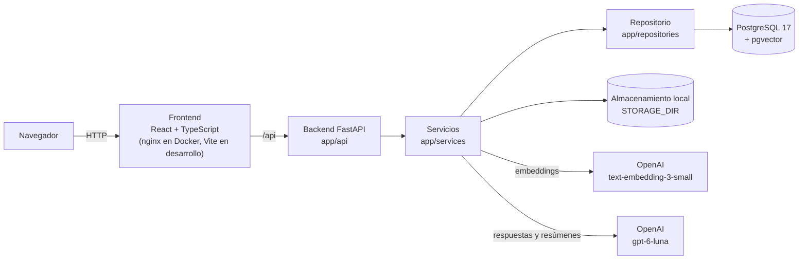
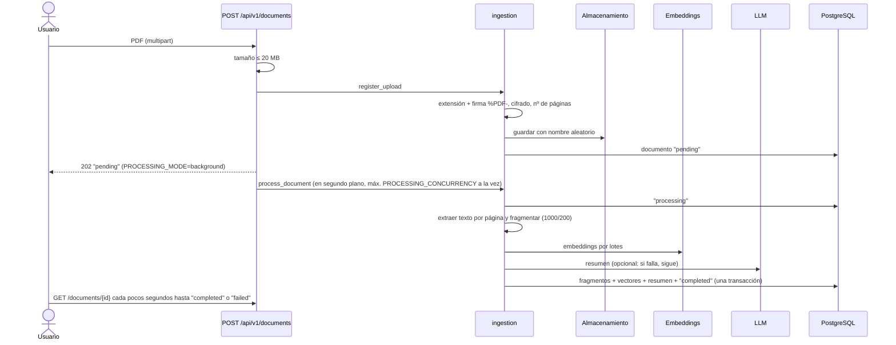
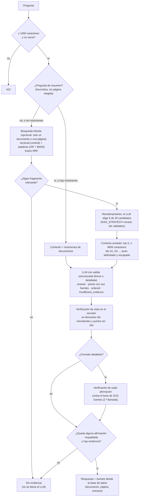
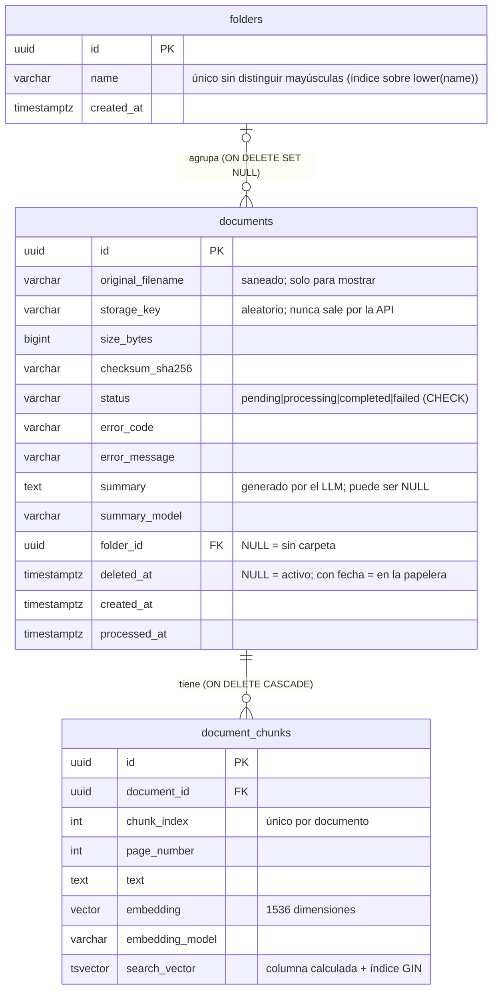

# Arquitectura

**Monolito modular**: un solo backend FastAPI con capas separadas (HTTP → servicios →
repositorio), un frontend React y PostgreSQL con pgvector. Los proveedores externos
(embeddings y LLM) están detrás de interfaces pequeñas para poder cambiarlos y simularlos en
las pruebas.

## Componentes

| Capa | Ubicación | Responsabilidad |
|---|---|---|
| HTTP | `backend/app/api/` | Validar entrada, traducir errores a códigos HTTP. Sin lógica de negocio |
| Servicios | `backend/app/services/` | Ingestión, extracción de PDF, fragmentación, embeddings, búsqueda, RAG, resúmenes, prompts |
| Repositorio | `backend/app/repositories/` | Consultas a PostgreSQL |
| Modelos | `backend/app/models/`, `schemas/` | Tablas ORM y contratos de la API (Pydantic) |
| Migraciones | `backend/migrations/` | Historial versionado del esquema (Alembic) |
| Frontend | `frontend/src/` | Biblioteca, preguntas, detalle; cliente HTTP tipado en `api/client.ts` |

## Flujo de ingestión

- **En segundo plano** (`services/processing.py`): la subida responde 202 en cuanto el archivo
  está validado y guardado; el procesamiento sigue en un hilo del servidor, limitado por un
  semáforo. Al arrancar se retoman los documentos que quedaron `pending` o `processing`.
  `process_document` solo necesita el id del documento, así que en la Fase 8 lo puede ejecutar
  un worker leyendo de una cola (SQS) sin cambiar su código. `PROCESSING_MODE=sync` mantiene el
  comportamiento anterior (útil en scripts y pruebas).
- **Atómico**: fragmentos, vectores y estado se confirman juntos. Las llamadas externas
  (embeddings, resumen) se hacen **antes** de escribir, sin transacción abierta.
- **Fallos explicables**: `failed` con `error_code` y un mensaje apto para el usuario; el
  detalle técnico va solo al log. Se puede reprocesar.

## Flujo de consulta

## Modelo de datos

Borrar una carpeta deja sus documentos sin carpeta. Un documento con `deleted_at` está en la
papelera: las búsquedas, los resúmenes y los listados lo excluyen, y la tarea
`purge_periodically` (`services/trash.py`) lo borra del todo pasados `TRASH_RETENTION_DAYS` días.

No hay tabla `queries`: las preguntas no se guardan (privacidad). Los logs registran métricas
de cada consulta (conteos, tokens, costo estimado, latencias, versión del prompt), nunca el
texto de la pregunta, de los documentos ni de la respuesta.

## Decisiones principales

| Decisión | Motivo | Detalle |
|---|---|---|
| OpenAI `text-embedding-3-small` | Barato, 1536 dimensiones, misma cuenta que el LLM | [ADR 0001](decisions/0001-proveedor-embeddings.md) |
| OpenAI `gpt-6-luna` | Costo bajo por pregunta, salida estructurada | [ADR 0002](decisions/0002-proveedor-llm.md) |
| Resumen al procesar | Las preguntas «¿de qué trata?» no funcionan con búsqueda por similitud | [ADR 0003](decisions/0003-resumen-de-documentos.md) |
| pgvector en PostgreSQL | Una sola base de datos para metadatos y vectores; transacciones | — |
| Búsqueda exacta, sin índice HNSW | Con pocos miles de fragmentos es rápida y no pierde resultados; el índice se añade cuando el volumen lo justifique | — |
| Búsqueda híbrida + RRF | Los embeddings fallan con códigos, nombres y números exactos | — |
| Formatos de respuesta con verificación | Las respuestas largas tienden a añadir lo que no está en los documentos | [ADR 0005](decisions/0005-formatos-de-respuesta.md) |
| Reordenar candidatos con el LLM | En documentos largos y repetitivos la respuesta queda fuera de los 5 primeros | [ADR 0004](decisions/0004-reordenamiento-con-llm.md) |
| Fragmentos por página | Cada fragmento pertenece a una sola página, para poder citarla | — |
| `VARCHAR` + `CHECK` para el estado | Más fácil de migrar que un `ENUM` nativo | — |
| Proveedores falsos | Pruebas y desarrollo gratis y deterministas; las pruebas reales van aparte (`-m openai`) | — |

## Seguridad (resumen)

- **Entradas**: tamaño, tipo real del archivo (firma), PDF cifrados, nº de páginas y longitud
  de la pregunta validados en el servidor. Nombres de archivo saneados y nunca usados en rutas.
- **Prompt injection**: el LLM no tiene herramientas ni ve secretos; el texto de los documentos
  va delimitado, escapado y declarado como datos; las citas se verifican en el servidor; la
  evaluación incluye un documento malicioso.
- **Salida**: el frontend muestra las respuestas y resúmenes como texto plano; nginx añade una
  CSP que impide cargar scripts o enviar datos a otros dominios.
- **Secretos**: solo en `.env` (ignorado por git), `SecretStr` en la configuración,
  `store=False` en las llamadas al LLM.
- **Contenedores**: usuarios sin privilegios; el backend no publica puertos (solo es accesible
  a través de nginx); PostgreSQL y el frontend solo escuchan en `127.0.0.1`.
- **Fuera del MVP**: autenticación, autorización por usuario, rate limiting y cuotas. Por eso
  **no debe exponerse a Internet** tal como está.

## Evolución prevista (Fase 8)

Almacenamiento en S3 (sustituyendo `LocalFileStorage`), procesamiento asíncrono con SQS y un
worker que llama a `process_document`, infraestructura con Terraform, IAM de mínimo privilegio
y secretos en un gestor de secretos.
